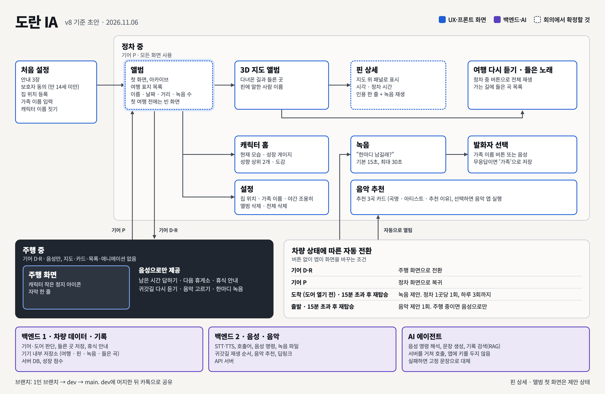

# 화면 구조

기획서 v8 기준 초안입니다. 점선 상자는 회의에서 확정할 항목입니다.

| 화면 | 경로 | 앱 폴더 |
| --- | --- | --- |
| 처음 설정 | `onboarding` | `ui/onboarding` |
| 앨범 | `album` | `ui/album` |
| 3D 지도 앨범, 핀 상세 | `album_map` | `ui/albummap` |
| 캐릭터 홈 | `character` | `ui/character` |
| 설정 | `settings` | `ui/settings` |
| 녹음 | `record` | `ui/record` |
| 발화자 선택 | `speaker_select` | `ui/record` |
| 음악 추천 | `music` | `ui/music` |
| 주행 화면 | `driving` | `ui/driving` |
